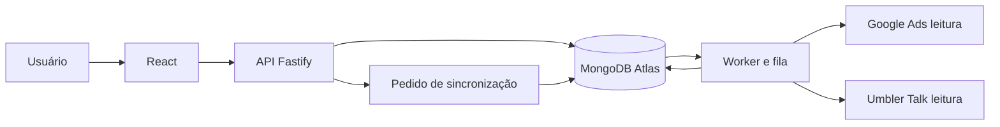

# Planejamento técnico do CRM JBR

Plano iniciado em 21/11/2026, atualizado em 24/11/2026: a aplicação local e o repositório já existem. **MongoDB Atlas substitui a proposta PostgreSQL/pg-boss.** O inventário, a configuração e a sequência de migração vigentes estão em [MongoDB Atlas](../MONGODB.md). Os documentos anteriores permanecem como referência de requisitos; escolhas de SQL/Drizzle/pg-boss não se aplicam à nova persistência.

## Diretrizes confirmadas

- Interface limpa: título curto, controles necessários e conteúdo. Sem subtítulos explicativos permanentes, banners metodológicos ou repetição de informações.
- WhatsApp/Umbler Talk exclusivamente de leitura. Nenhum envio, alteração de conversa, marcação de leitura ou automação de resposta no provedor.
- Chamadas externas centralizadas, com fila, controle de concorrência, limite de consumo e gravação idempotente.
- Desenvolvimento local primeiro; GitHub e Render depois, usando a mesma base de código.
- Todos os novos arquivos pertencem a `CRM JBR`. Os outros projetos continuam como fontes, sem dependência de execução.

## Decisão de arquitetura

Adotar **React + TypeScript + Vite** na interface, **Node.js + Fastify** na API e **MongoDB Atlas**, com driver oficial e tarefas persistidas no banco. Um único repositório, com API e worker separados. O worker sincroniza os provedores e atualiza os dados; a interface consulta o banco por meio da API interna.

É um monólito modular com API e worker separados. Jobs, cursores, leases e limites ficam no MongoDB com índices únicos e operações atômicas. A migração foi executada: painéis e sincronizações usam Atlas; SQLite/JSON permanecem como backup histórico. O estado validado está em [MONGODB.md](../MONGODB.md).

Abertura de telas, filtros e atualização da interface **não iniciam coleta externa**. A sincronização tem agenda própria; o comando administrativo manual entra na mesma fila e usa as mesmas travas.

## Documentos de execução

| Documento | Decisões que contém |
| --- | --- |
| [MongoDB Atlas — plano vigente](../MONGODB.md) | Diagnóstico atual, organização/projeto/cluster, coleções, migração e critérios de troca. |
| [Arquitetura e estrutura](01-arquitetura.md) | Stack, módulos, estrutura futura e contratos entre processos. |
| [Interface limpa](02-interface.md) | Layout, comportamento de cada tela, cache e atualização. |
| [Sincronização e duplicidade](03-sincronizacao.md) | Fila, chaves, travas, limites, retomada e reconciliação. |
| [Banco e API interna](04-banco-e-api.md) | Entidades físicas, índices, contratos HTTP e limites de consulta. |
| [Segurança](05-seguranca.md) | Autenticação, permissões, segredos, conteúdo e auditoria. |
| [Local, GitHub e Render](06-ambientes-e-deploy.md) | Instalação futura, configuração, pipeline, migração e operação. |
| [Implementação e aceite](07-implementacao-e-aceite.md) | Ordem de desenvolvimento, cenários de teste e critérios de conclusão. |

## Alcance da garantia contra duplicidade

O objetivo verificável é evitar concorrência indevida e repetição desnecessária de chamadas, além de impedir que reexecuções dupliquem mensagens, cadastros e métricas. Uma resposta de leitura perdida na rede pode exigir repetir a chamada. Não é possível garantir uma única requisição física em todas as falhas de rede ou quedas de processo; o sistema deve reconhecer a repetição e preservar um único resultado lógico.

As travas coordenam processos que compartilham o mesmo banco. O coletor antigo, outro sistema usando o mesmo developer token ou um ambiente local com banco independente não participa automaticamente dessa coordenação. A operação prevê somente um ambiente coletor ativo por vez para os mesmos recursos.

## Decisões que podem esperar

Não impedem a construção local: domínio final, planos contratados do Render, lista final de usuários/canais, prazo de retenção comercial e fechamento das etapas do funil. Entram como configuração ou pendência explícita antes do piloto. Não serão preenchidos com dados fictícios nem credenciais no código.

As imagens anteriores são estudos da identidade e da organização das telas. O documento de interface deste plano prevalece sobre os subtítulos, avisos e blocos explicativos presentes nesses PNGs.
